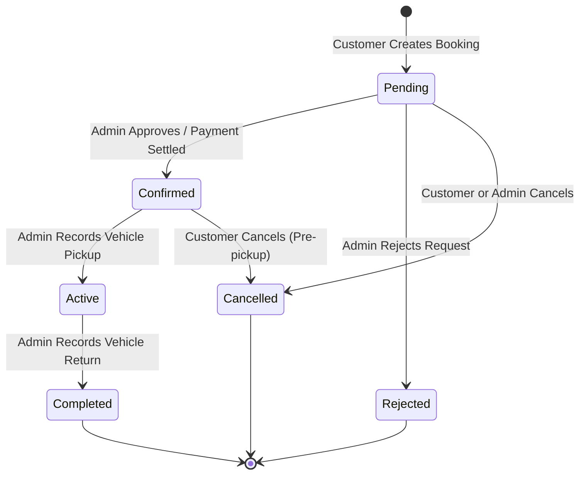

# Motivo Booking Lifecycle & State Machine

Motivo implements a strict finite state machine for all vehicle reservations to prevent inconsistent states.

## 1. Concurrency & Availability Condition

When verifying vehicle availability across date windows, Motivo evaluates:

$$\text{existingPickup} < \text{requestedReturn} \quad\land\quad \text{existingReturn} > \text{requestedPickup}$$

### Why this formula is mathematically sound:
1. **Adjacent Handover Allowed**: If Booking A returns at `10:00 AM` on Nov 5th and Booking B picks up at `10:00 AM` on Nov 5th, `existingReturn > requestedPickup` evaluates to `false` ($10:00 > 10:00$ is false). Hence, adjacent bookings are safely permitted.
2. **Cancelled/Rejected Ignored**: Bookings with status `Cancelled` or `Rejected` do not block the timeline.
3. **Operational Status Enforced**: A vehicle with status `Maintenance` or `Retired` cannot be booked under any circumstances.

## 2. Server-Side Authoritative Pricing Rule

All monetary values are denominated in Indian Rupees (INR).

$$\text{billableDays} = \lceil \frac{\text{rentalDuration}}{24 \text{ hours}} \rceil$$

$$\text{baseCharge} = \text{dailyRate} \times \text{billableDays}$$

$$\text{taxableAmount} = \text{baseCharge} + \text{additionalCharges} - \text{discounts}$$

$$\text{totalAmount} = \text{taxableAmount} + \text{round}(\text{taxableAmount} \times 0.18)$$

- The browser client only displays an estimate. The server independently recalculates all durations, day ceilings, and totals prior to saving the booking document.
